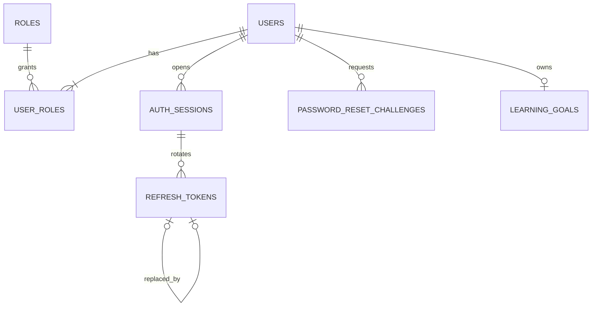

# Database baseline v3

> Bản lịch sử, đã được thay thế ngày 25/10/2026 bởi
> [APPROVED_BASELINE.md](APPROVED_BASELINE.md) sau khi duyệt D01–D29/B01–B37.
> Số 44 bảng, display_name và mô hình cũ bên dưới không phải thiết kế hiện hành.
> Giữ nội dung để truy vết phần code/migration đã có trước lượt chốt.

Ngày rà soát 25/10/2026. Phạm vi BE và FE của EnglishMaster, AI làm sau.

Quyết định mới đã được người dùng xác nhận: **một user có thể có nhiều role**.
Hồ sơ giữ **số điện thoại và avatar**, ngoài email và tên hiển thị.
Bản này thay thế quy tắc một role/user trong các tài liệu cũ. Những thay đổi còn
lại dưới đây là phương án kỹ thuật để review, không tự coi là nghiệp vụ đã duyệt.

## Trạng thái và nguồn đối chiếu

- M01: đã sửa entity, viết Flyway V2 và kiểm thử PostgreSQL 17.
- Các module còn lại: SQL đề xuất đầy đủ nằm ngoài Flyway locations.
- M07 AI: để sau, không tạo bảng trong đợt này.
- Nguồn: Database Design Living v2.1, SRS/SDD v4.2 và Quy chuẩn API v1.0 trong
  `D:\MasterEnglish\docs`. Các DOCX gốc được giữ nguyên.
- Thiết kế tổng thể: **43 bảng nghiệp vụ + event_publication = 44 bảng**.
- V1 + V2 tạo 8 bảng ứng dụng/framework. Metadata `flyway_schema_history` không
  nằm trong các số đếm trên.

## Quy ước chung

| Chủ đề | Quyết định |
|---|---|
| Kiến trúc | Một PostgreSQL 17, schema public, bảng có owner module |
| Role | users N:N roles qua user_roles; không có users.role_id |
| ID | UUID cho tài nguyên; SMALLINT cho catalogue role; khóa ghép cho bảng nối |
| Thời gian | TIMESTAMPTZ/Instant, UTC ở JVM; DATE/TIME dùng đúng mục đích |
| Enum | VARCHAR + CHECK, API dùng UPPER_SNAKE_CASE |
| Email | Trim/lowercase tại service; DB unique index lower(email) |
| Schema | Flyway quản lý, Hibernate validate; giữ nguyên V1 đã sử dụng |
| Xóa | Account dùng status; content archive; giữ lịch sử bài làm |
| Secret | Password hash; token SHA-256; OTP HMAC; secret server ở môi trường |
| Media | DB giữ metadata/object key, file ở R2 |
| Events | Dùng schema thực event_publication của Modulith 2.1, không thêm registry custom |

## Danh sách toàn bộ bảng

| Owner | Số bảng | Danh sách |
|---|---:|---|
| M01 Identity | 7 | roles, users, user_roles, auth_sessions, refresh_tokens, password_reset_challenges, learning_goals |
| M08 Content | 7 | content_items, content_revisions, content_sources, content_source_links, media_assets, import_jobs, import_job_errors |
| M03 Vocabulary | 7 | words, word_senses, decks, deck_words, user_saved_words, user_word_progress, word_reviews |
| M04 Grammar | 3 | grammar_topics, grammar_lessons, lesson_progress |
| M05 Practice | 9 | questions, question_options, question_groups, group_questions, group_materials, practice_sets, set_items, question_words, question_topics |
| M06 Results | 4 | attempts, attempt_question_snapshots, attempt_answers, mistake_records |
| M10 Notifications | 4 | notifications, notification_preferences, reminder_rules, notification_deliveries |
| M09 Administration | 2 | system_settings, audit_logs |
| Infrastructure | 1 | event_publication |
| **Tổng** | **44** | M02 Dashboard không cần bảng riêng |

Sau này thêm ai_requests và ai_usage thì tổng là 46 bảng. Không đưa số bảng metadata
Flyway vào số bảng nghiệp vụ/framework.

## M01 Identity và tài khoản

| Bảng | Nội dung chính | Ràng buộc ở DB |
|---|---|---|
| roles | id SMALLINT, code, name | PK, unique code, CHECK 3 role |
| users | UUID, email, password_hash, display_name, phone, avatar_media_id, status, auth_version, password_changed_at, version, created_at, updated_at | Unique lower(email), CHECK status/counter/phone |
| user_roles | user_id, role_id, assigned_at | PK(user_id,role_id), FK cả hai phía, index(role_id,user_id) |
| auth_sessions | user, thiết bị, hạn phiên, thời gian/lý do thu hồi | FK user, expires_at sau created_at, revoke_reason đi kèm revoked_at |
| refresh_tokens | session, hash, issued/expiry, revoked, replaced_by, last_used | Unique hash, một token chưa revoke/session, replacement cùng session |
| password_reset_challenges | HMAC, attempt_count, hạn OTP, verified/consumed/invalidated, reset grant hash, last_sent | Một challenge chưa đóng/user, 0..5 lần sai, grant có hạn sau verify |
| learning_goals | user_id PK/FK, target_score, daily_minutes, target_date, timestamps | Một mục tiêu/user, điểm 10..990 bội 5, phút/ngày 5..240 |

`version` dùng optimistic locking; `auth_version` dùng vô hiệu token/danh tính cũ.
Role không kế thừa BaseEntity. Bảng nối dùng khóa ghép, không cần UUID phụ.

Phone nullable, tối đa 30 ký tự, không unique và không dùng để đăng nhập/SMS trong
phạm vi hiện tại. Avatar nullable, lưu media ID thay vì URL tùy ý. V2 có cột
avatar_media_id; FK được thêm cùng M08 sau khi media_assets tồn tại. Vì vậy chưa
phát hành chức năng đổi avatar trước khi có migration và luồng upload M08.

Media avatar có purpose=AVATAR, phải là ảnh READY của chính user; service kiểm tra
ownership/MIME/kích thước qua API media. Uploader avatar có thể là Learner; quyền
upload nội dung CONTENT vẫn dành cho Content Admin. File thực nằm trên R2.
Đổi profile không làm tăng auth_version; đổi role/status/password thì có.

### Quyền sau thay đổi nhiều role

- Đăng ký công khai luôn gán LEARNER, không nhận role từ request.
- User có ít nhất một role qua service; aggregate chặn xóa role cuối.
  PK/FK không tự bảo đảm số role tối thiểu; chưa dùng trigger cho điều kiện này.
- SYSTEM_ADMIN không tự có quyền CMS. Một user được gán cả SYSTEM_ADMIN và
  CONTENT_ADMIN thì có cả hai quyền.
- Learning goal yêu cầu role LEARNER, kể cả user có thêm role khác.
- DTO danh tính và JWT dùng `roles` array thay `role` đơn của hợp đồng cũ.
  Giữ các claim sub/sid/ver/iss/aud/iat/exp/jti.
- Sửa role/status/password tăng auth_version; service phải thu hồi session/token
  trong cùng transaction và kiểm tra version/session khi xác thực.
- Service quản trị phải bảo vệ SYSTEM_ADMIN cuối cùng của hệ thống và ghi audit.
  Luồng quản trị/auth này chưa được triển khai trong đợt tối ưu base.

### Phiên, refresh và reset password

Khóa row auth_sessions trước khi refresh; kiểm tra user/phiên/hạn, revoke token cũ
rồi insert token mới trong một transaction. FK replacement deferrable cho phép
thứ tự này nhưng vẫn bảo đảm token thay thế thuộc cùng session.

Partial unique index chỉ bảo vệ một token **chưa revoke**, không chứng minh còn hạn.
Không đưa now() vào predicate. Token/challenge hết hạn cần đóng trước khi phát mới.

OTP 6 số, HMAC kèm challenge ID và secret server, TTL 5 phút, tối đa 5 lần sai,
resend ít nhất 60 giây. Reset grant được hash riêng, dùng một lần, TTL đề xuất
5 phút sau verify. Verify/consume/counter/password cần transaction chống race.

Không persist OTP plaintext vào event/outbox. Không seed tài khoản admin có
mật khẩu cố định trong migration. Retention session/reset/audit cần chốt trước production.

## M08 Nội dung và bản công bố

Chọn mô hình **draft ở content_revisions, bảng domain là projection bản đã publish**:

1. Admin sửa snapshot DRAFT có schemaVersion, không ghi đè projection Learner đang đọc.
2. Validator kiểm tra cấu trúc, media READY, license, dependency, CEFR, số lựa chọn.
3. Transaction khóa item, cập nhật projection domain, revision PUBLISHED và pointer;
   dùng version để phát hiện biên tập cạnh tranh.
4. Revision đã công bố bất biến qua API; thay đổi nội dung tạo revision mới.
5. Learner chỉ đọc item có published pointer và chưa archive.

FK ghép bảo vệ pointer thuộc đúng item. Trạng thái PUBLISHED, content_type đúng
bảng domain, immutability và đồng bộ snapshot/projection cần service/transaction;
SQL đề xuất chưa dùng trigger cho các điều kiện này.

Giữ nguồn/license và media đang được tham chiếu. Import có job + báo lỗi dòng;
dữ liệu hợp lệ vẫn DRAFT, không tự publish.

## M03 Từ vựng và SRS

- Words là lemma; word_senses giữ nghĩa, POS và CEFR A1..C2.
- Không unique tuyệt đối lemma; progress SRS và saved gắn theo word_sense_id.
- Bỏ saved không xóa progress/review; retire sense bằng is_archived để giữ lịch sử.
- CEFR còn nullable trong DDL như baseline cũ; publish phải chặn CEFR chưa xác định.
- Review nhận Idempotency-Key UUID, lưu word_reviews.request_id unique theo user.
  Cùng key/cùng payload trả kết quả cũ; khác payload trả conflict.
- Update progress và append review atomic; version ngăn ghi đè cạnh tranh.
  Chỉ khóa transaction không ngăn hai request lặp tuần tự.

Thuật toán SRS cụ thể cần xác định khi làm M03. Các cột interval/ease/repetitions
kế thừa mô hình SM-2 trong baseline; chưa triển khai thuật toán trong đợt này.

## M04 và M05 Grammar và Practice

Grammar sở hữu bài học/progress, không tách grammar_attempts hay vocabulary_tests.
Vocabulary, Grammar và TOEIC dùng chung question bank và practice engine.

| Quan hệ | Bảo vệ |
|---|---|
| question/options | UNIQUE(question,position), partial unique tối đa 1 correct |
| group/questions/materials | Thứ tự unique; kiểm tra khớp Part ở service |
| set/items | CHECK một question hoặc một group; không cùng có/cùng thiếu |
| question/word_senses/topics | Bảng nối FK rõ ràng |
| lesson progress | PK(user,lesson), completed_at khớp state |

P0 đề xuất MULTIPLE_CHOICE/FILL_OPTION. Các nhóm đề xuất PHOTO, QUESTION_RESPONSE,
CONVERSATION, TALK, TEXT_COMPLETION, PASSAGE. Enum DTO cụ thể cần đồng bộ FE/BE.
Part 2 có 3 lựa chọn; Part 3/4 lấy nguyên nhóm để không làm vỡ audio/context.

Publish validator kiểm tra ít nhất một correct, số lựa chọn, media và dependency.
Partial unique chỉ bảo đảm **tối đa một** correct, không thay thế validator.

## M06 Bài làm và kết quả

- Tạo attempt đóng băng câu, option, group/material và đáp án.
- Snapshot giữ source_revision_id để truy xuất nguồn.
- Không trả answer_key_snapshot/explanation trước submit.
- selected_option_id thuộc JSON snapshot, không FK tới option hiện hành.
  Service kiểm tra membership và ownership, không tin ID do FE gửi.
- Submit khóa attempt; đã SUBMITTED thì trả kết quả cũ.
- Ghi điểm + cập nhật mistakes trong cùng transaction, rồi mới phát event.
- Mistake là một bản tổng hợp/user/question. Lịch sử từng lỗi nằm ở
  attempts/snapshots/answers; không tăng counter qua consumer có thể retry.
- Composite FK bảo vệ source snapshot thuộc attempt và source attempt thuộc user.

## M10 và M09

Notification dedupe theo user/event key. Một delivery/notification/channel với
counter retry. Worker claim bằng row lock/SKIP LOCKED, giới hạn retry; DB dedupe
không tự bảo đảm provider email chỉ gửi một lần khi crash giữa gửi và commit.

Email học tập opt-in; timezone IANA phải được service kiểm tra; quiet hours cùng
có/không. Audit append-only qua service, không có secret; settings có allowlist
và schema theo key. Actor hệ thống có thể NULL.

## Bổ sung kỹ thuật so với v2.1

| Thay đổi | Mục đích |
|---|---|
| user_roles thay users.role_id | Quyết định nhiều role đã xác nhận |
| phone, avatar_media_id và media_assets.purpose | Người dùng xác nhận giữ phone/avatar; phân biệt ảnh hồ sơ với nội dung CMS |
| users.version và auth_version riêng | Optimistic locking và thu hồi quyền |
| Hash VARCHAR(64) + CHECK hex | Không padding CHAR, bảo vệ định dạng hash |
| Replacement FK cùng session, deferrable | Rotation atomic, không nối sang phiên khác |
| word_senses.is_archived | Giữ ID đã có lịch sử SRS |
| word_reviews.request_id và progress.version | Idempotency và cập nhật cạnh tranh |
| content_items.version | Phát hiện biên tập cạnh tranh |
| source_revision_id trong attempt snapshot | Truy xuất bản được giao |
| Composite FK nguồn mistake | Ngăn gắn nhầm user/attempt/snapshot |
| Chỉ event_publication framework | Không tạo registry logic thứ hai |

Các điều chỉnh ngoài M01 ở trên là đề xuất cần review trước khi chuyển thành migration.

## Thứ tự migration và áp dụng

| Migration | Nội dung | Trạng thái |
|---|---|---|
| V1 | Registry Modulith | Đã có, giữ nguyên |
| V2 | 7 bảng M01 + seed role | Đã thêm và kiểm thử container |
| V3 | M08 content/media | Đề xuất |
| V4 | M03 vocabulary | Đề xuất |
| V5 | M04 grammar | Đề xuất |
| V6 | M05 practice | Đề xuất |
| V7 | M06 attempts/results | Đề xuất |
| V8 | M10 notifications + M09 system | Đề xuất |
| Sau đó | AI, retention, tối ưu theo số đo | Giai đoạn sau |

SQL M01: `src/main/resources/db/migration/V2__create_identity_account.sql`.
SQL 36 bảng còn lại: `docs/database/proposals/remaining-mvp.sql`; không tự chạy
vì nằm ngoài Flyway locations.

Lần khởi động BE tiếp theo, Flyway sẽ thêm 7 bảng M01 nếu database mới có V1.
Không cần xóa volume, sửa V1 hoặc dùng ddl-auto=update.

## Kiểm chứng và giới hạn

Lệnh `.\gradlew.bat test bootJar`, JDK 21, Docker Desktop. Test dùng PostgreSQL 17
riêng, không dùng credential hay dữ liệu local/EC2.

Kiểm thử gồm mapping nhiều role, auth_version, unique email/link, refresh rotation
và cross-session FK, reset grant/OTP, goal, toàn bộ DDL 44 bảng, published pointer,
correct option, set XOR, ownership nguồn mistake, notification dedupe, JSON error,
sort allowlist và ranh giới Modulith.

SQL đề xuất được tạo trong transaction test và rollback sau test. Chưa benchmark,
chưa kiểm thử toàn bộ luồng auth/publish/reminder; chưa thực hiện backup/restore EC2.
Cần xác định retention, tài khoản DB runtime/migration và đo tải trên t3.small trước
production. Không thêm Kafka, Redis, partitioning hoặc index JSON hàng loạt khi
chưa có truy vấn và số đo cần thiết.
