# ERD — database đã duyệt

Ngày 25/10/2026. Sơ đồ chia theo module để dễ đọc; FK/nullable/unique chính xác nằm ở DATA_DICTIONARY.md và SQL.
Các cạnh biểu diễn tham chiếu entity; quan hệ 1:1 được ràng buộc bằng PK/UNIQUE trong dictionary. ID projection dùng cùng UUID với content_items.

## Luồng chính

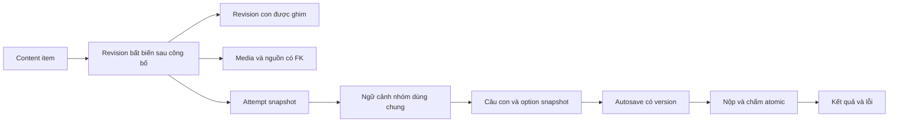

## Identity

```mermaid
erDiagram
    ROLES {
        string primary_key
    }
    MEDIA_ASSETS |o--o{ USERS : "avatar_media_id"
    USERS ||--o{ USER_ROLES : "user_id"
    ROLES ||--o{ USER_ROLES : "role_id"
    USERS |o--o{ USER_ROLES : "assigned_by"
    USERS ||--o{ AUTH_SESSIONS : "user_id"
    AUTH_SESSIONS ||--o{ REFRESH_TOKENS : "session_id"
    REFRESH_TOKENS |o--o| REFRESH_TOKENS : "session_id_replaced_by_id"
    USERS ||--o{ OTP_CHALLENGES : "user_id"
    USERS ||--o{ REGISTRATION_REQUESTS : "user_id"
    OTP_CHALLENGES ||--o| REGISTRATION_REQUESTS : "user_id_otp_purpose_otp_challenge_id"
    USERS ||--o{ PASSWORD_CHANGE_REQUESTS : "user_id"
    OTP_CHALLENGES ||--o| PASSWORD_CHANGE_REQUESTS : "user_id_otp_purpose_otp_challenge_id"
    AUTH_SESSIONS ||--o{ PASSWORD_CHANGE_REQUESTS : "user_id_session_id"
    USERS ||--o{ PASSWORD_RESET_GRANTS : "user_id"
    OTP_CHALLENGES ||--o| PASSWORD_RESET_GRANTS : "user_id_otp_purpose_otp_challenge_id"
    AUTH_RATE_LIMITS {
    AUTH_RATE_LIMITS ||--o{ AUTH_RATE_LIMIT_EVENTS : "rate_limit_id"
```

## Content

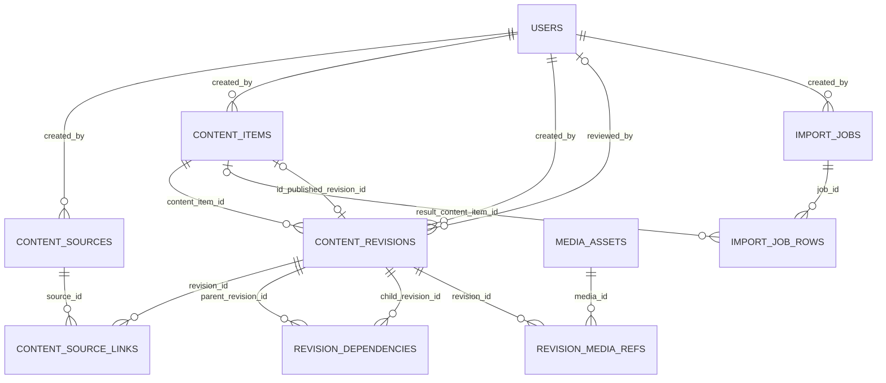

## Media

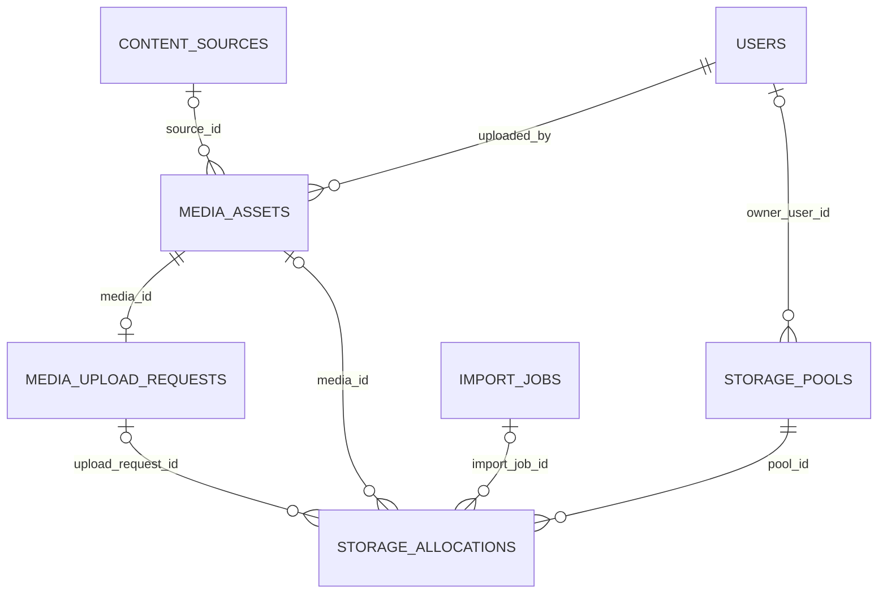

## Vocabulary

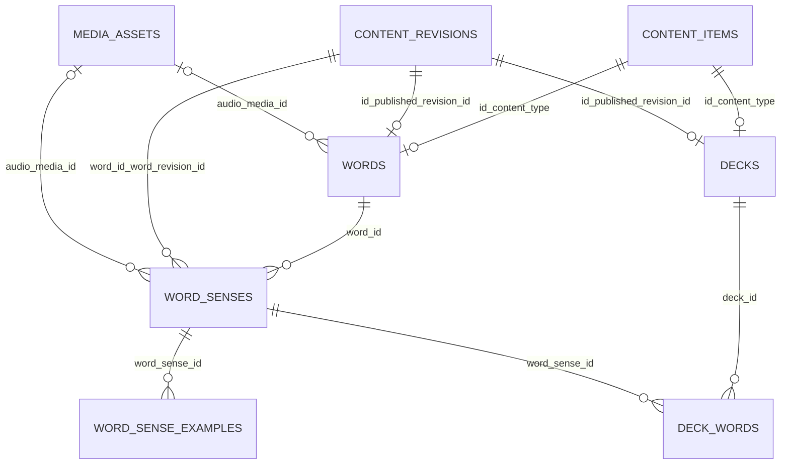

## Learning

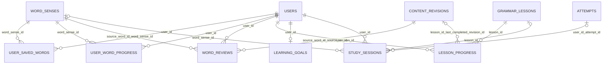

## Grammar

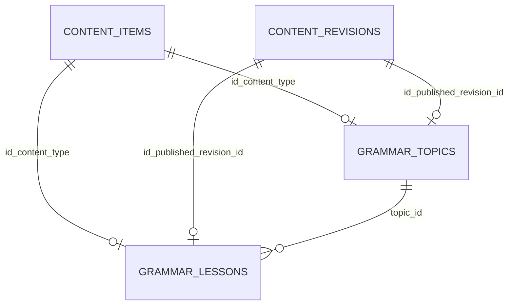

## Practice

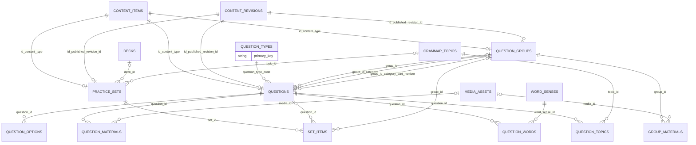

## Results

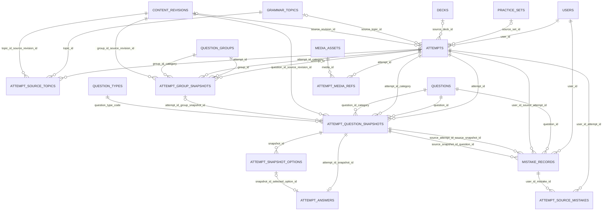

## Notifications

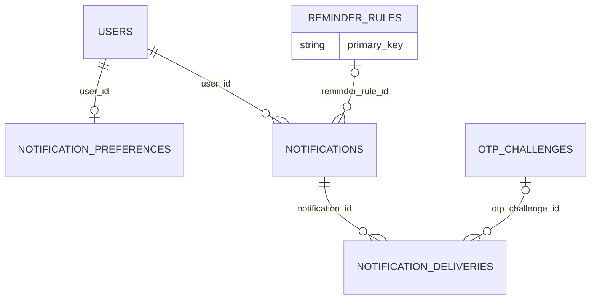

## Administration

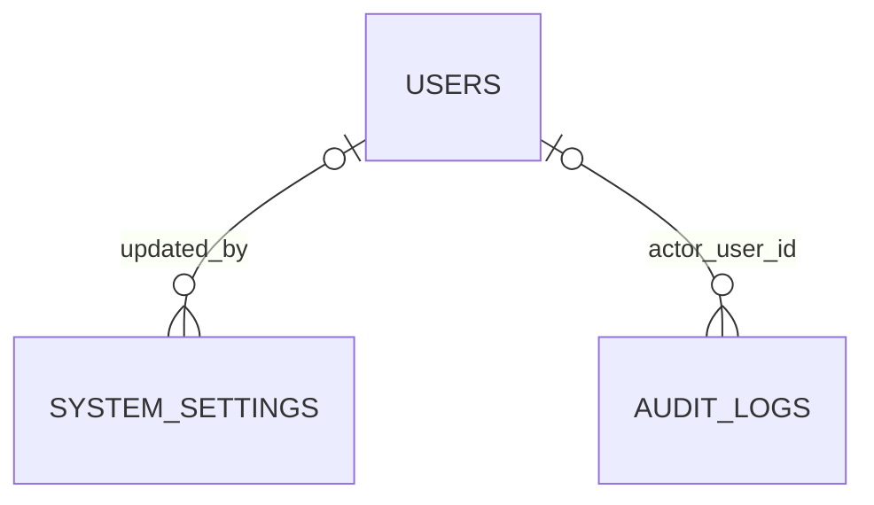

## Infrastructure

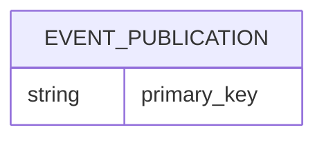

## Quan hệ đáng chú ý

- users N:N roles; min một role và bảo vệ admin cuối có guard riêng.
- questions.group_id là N:1; không có bảng group_questions N:N. Cờ in_current_group chỉ là membership của projection hiện hành, không đổi context gốc.
- content_items.published_revision_id trỏ về revision của chính item; quan hệ vòng được deferred.
- attempt_answers chọn option bằng FK kép (snapshot_id, option_id), không tham chiếu option hiện hành.
- storage_allocations ghi giữ chỗ/commit/release và cập nhật pool có khóa, không tính quota bằng SUM thiếu phối hợp.
- Nguồn attempt nhiều topic/lỗi và media trong JSON có bảng FK để kiểm tra ownership và giữ lịch sử.
