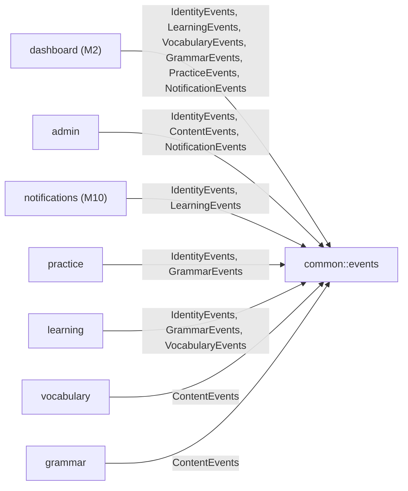

# M10 + M2 Final Handover Report — MasterEnglishhh Backend

## 1. Những chức năng đã hoàn thiện

### M10 – Notification (`feat/m10-notification-complete`, PR #16)
- **M10.01–M10.04:** Notification feed (`GET /api/v1/notifications`, lọc `type` & `unreadOnly`), đếm chưa đọc (`unread-count`), đánh dấu đã đọc đơn lẻ idempotent & hàng loạt (`/{id}/read`, `/read-all`), quản lý preferences (`inAppEnabled`, `emailEnabled`, `contentNotificationsEnabled` mặc định `false`, `dailyReminderTime`, IANA `timezone`, `quietHoursStart/End`) bằng PostgreSQL atomic upsert (`ON CONFLICT DO UPDATE`).
- **M10.05–M10.08:** Scheduler nhắc Flashcard đến hạn (`REVIEW_DUE`) và nhắc mục tiêu hằng ngày (`DAILY_GOAL` đối chiếu `learning_goals.daily_minutes` và `study_sessions`), listener bất đồng bộ qua Spring Modulith outbox cho nội dung mới (`CONTENT_NEW` khi công bố thủ công lần đầu một `DECK`), cùng worker gửi email outbox (`FOR UPDATE SKIP LOCKED`, lease 60s, retry 1/5/30 phút).
- **M10.09–M10.11:** API vận hành cho `SYSTEM_ADMIN` (`/api/v1/admin/notifications/deliveries`, `/rules`, `/rules/{ruleId}` ghi `audit_logs`, `/history`) và tra cứu lịch sử nhắc cho Learner (`/api/v1/notifications/reminders/history`), kèm API `study_sessions` (`POST /api/v1/study-sessions/**`).

### M2 – Learner Dashboard & Practice/Results (`feat/m2-learner-dashboard`, PR #17)
- **M02.01 & M02.03:** Thống kê từ vựng (`VocabularyProgressSummary` khớp 100% `GET /api/v1/vocabulary/progress`) và hàng ôn tập hôm nay (`dueNow`, `savedSenses`, top `dueDecks`).
- **M02.02 (Grammar hoàn chỉnh; TOEIC chờ V14):** Tổng hợp `grammarLessons` (`V12` `lesson_progress`) và `grammarPractice` (`V13` `attempts`), đồng thời khai báo tường minh `toeicListening` (Parts 1–4) và `toeicReading` (Parts 5–7) ở trạng thái `UNAVAILABLE_PENDING_MIGRATION` (không giả lập số liệu TOEIC).
- **M02.04 (Grammar hoàn chỉnh; TOEIC chờ V14):** Phân tích điểm yếu 30 ngày (`>= 20` câu đã chấm, `< 70%`) phân biệt rõ **4 trạng thái**: `NO_DATA` (0 câu), `INSUFFICIENT_DATA` (`> 0` câu nhưng chưa đủ 20 câu/chủ điểm), `NO_WEAKNESS_DETECTED`, `READY`, kèm cấu trúc scope riêng cho Grammar và TOEIC Listening/Reading.
- **M02.05:** Gợi ý quy tắc xác định, có trường truy vết `skill` và `reasonCode`, ưu tiên thẻ đến hạn, chủ điểm ngữ pháp yếu, bài học tiếp theo và từ đã lưu; không dùng M7 AI Tutor.
- **M02.06 & Phân tách 4 khái niệm (Phương án C):** `DashboardResponse.studyPlan` tách bạch **`StudyGoalSummary`** (`plannedDailyMinutes`), **`ToeicTargetSummary`** (`targetScore`, `targetDate`, `currentScore=null`), **`StudyScheduleSummary`** (`available=false`, `supportedModes=[MANUAL, TOEIC_GOAL_PROPOSED]`), và **`StudySessionSummary`** (`trackingAvailable=true`, `todayActualMinutes` tổng hợp thực từ `study_sessions` qua `LearningEvents.getDailyStudySeconds`, `dailyGoalCompleted`, tách riêng khỏi `plannedDailyMinutes`); `streakDays` tính cả ngày có `study_sessions.active_seconds > 0`; giữ nguyên tương thích `GET|PUT /api/v1/users/me/goal` cho `masterenglish-web`.
- **Practice/Results trên `V13`:** Bổ sung `GET /api/v1/attempts` truy vấn lịch sử lượt làm bài có lọc `status`, `sourceType`, phân trang `PageResponse<AttemptSummaryResponse>`, batch-load `topicIds` cho `MIXED_GRAMMAR` và kiểm soát chặt `LEARNER` ownership; đồng thời cung cấp `PracticeEvents.getPracticeSummary`.

## 2. Phạm vi chờ milestone khác ngoài M10/M2
1. **Phương án C – `Study Schedule` & `TOEIC Target` baseline:** `study_schedules` và cột điểm hiện tại TOEIC (`current_score`/`listening_score`/`reading_score`) chưa được định nghĩa trong `approved-baseline.sql` / SRS V2; giữ `available=false` theo chính sách không giả lập.
2. **Practice/Results TOEIC Listening (Parts 1–4) & TOEIC Reading (Parts 5–7) + `mistake_records`:** Thuộc phạm vi `V14__practice_results_expand.sql` (`docs/practice/CONTRACT.md` D8).

## 3. Những file đã thêm/sửa
- Chi tiết danh sách file cho **PR #16 (`feat/m10-notification-complete`)** xem tại `docs/reports/M10_IMPLEMENTATION_REPORT.md`.
- Chi tiết danh sách file tạo mới và chỉnh sửa cho **PR #17 (`feat/m2-learner-dashboard`)** so với `feat/m10-notification-complete` xem tại mục 6 của `docs/reports/M2_IMPLEMENTATION_REPORT.md` (tổng gồm module `dashboard`, mở rộng `common/events/*`, các query/service handler của `identity`, `notifications`, `learning`, `vocabulary`, `grammar`, `practice` gồm `GET /api/v1/attempts`, bộ unit/integration/ArchUnit tests và báo cáo kỹ thuật).

## 4. Database Migration & Flyway Audit
| Version | Nguồn | Trạng thái & Bằng chứng |
|---|---|---|
| `V1`–`V10`, `V12`, `V13` | `origin/main` (`4afb631`) | Đã có trên nhánh gốc; `V13` khóa `category = 'GRAMMAR'` và `source_type IN ('GRAMMAR_TOPIC', 'MIXED_GRAMMAR')` |
| `V11__create_notifications.sql` | PR #16 (`feat/m10-notification-complete`) | Nguyên bản từ `origin/feat/thong-bao-nhac-hoc-v11` (Git blob SHA-1: `2d6136fc3fb5c8c17a6f9fe1b1bd0f359f5b70bf`). **Cảnh báo:** bản `V11` trên local `dev` (`5953194`) có Git blob SHA-1 khác (`124e9d640517754c40ff98b1e0d348b0ca6884b3`) |
| `V14` | `docs/practice/CONTRACT.md` (D8) | Đóng băng chờ bằng chứng `flyway_schema_history` (Q1–Q8) trước khi mở rộng Practice/Results TOEIC |
| `V15__create_media_upload_and_quota_ledger.sql` | `origin/feat/m08-content-ops` (`c59c75e`) | Đã chiếm số version `V15` trên nhánh M08 (`storage_pools`, `media_upload_requests`) |
| `V14`/`V16+` mới | *Không tạo (STOP)* | Không truy cập được `flyway_schema_history` trên DB dùng chung (chỉ có `.env.example` và `application-local.properties` trong repo); dừng thay đổi schema để tuân thủ nghiêm quy tắc mục 8 |

## 5. API & Event Contracts mới hoặc thay đổi
- **PR #16 (M10):** xem `docs/notifications/CONTRACT.md` (12 endpoints Learner & Admin `SYSTEM_ADMIN` + `IdentityEvents`, `LearningEvents`, `NotificationEvents`, `ContentEvents.recordAuditLog`).
- **PR #17 (M2 + Practice V13):**
  - `GET /api/v1/dashboard` (`LEARNER`): thêm `studyPlan` (tách 4 khái niệm `studyGoal`, `toeicTarget`, `studySchedule`, `studySession`), breakdown Grammar Lessons / Grammar Practice / TOEIC Listening / TOEIC Reading trong `practiceStatistics` và `weaknessAnalysis` (`NO_DATA` tách khỏi `INSUFFICIENT_DATA`), và `skill`/`reasonCode` trong `recommendations`.
  - `GET /api/v1/attempts` (`LEARNER`): `PageResponse<AttemptSummaryResponse>` lọc theo `status`, `sourceType`, `page`, `size`.
  - Giữ nguyên **100% tương thích** `GET|PUT /api/v1/users/me/goal` cho `masterenglish-web` (`goal-client.ts`).
  - Liên kết module qua `common/events/*` đúng chuẩn Spring Modulith + ArchUnit.

## 6. Kiến trúc Module Dependency Map

## 7. Kết quả kiểm thử thực tế & CI Status
- **PR #16 (`feat/m10-notification-complete`):**
  - Local (Windows, không Docker): `spotlessCheck`, 8 unit/ArchUnit test classes, `bootJar` **PASS**.
  - GitHub Actions Backend CI (`run 45539073298`, commit `fd4f5f5e7ec3bdebf45e98a48e0999fae5406ef8`, `ubuntu-24.04` với Docker & PostgreSQL 17 Testcontainers): **PASS**.
- **PR #17 (`feat/m2-learner-dashboard`):**
  - Local (Windows, không Docker): `spotlessApply`, `spotlessCheck`, `bootJar`, `ArchitectureTests` (1), `LayerArchitectureTests` (13), `DashboardControllerUnitTests` (1), `DashboardServiceImplTests` (6), `PracticeServiceHistoryUnitTests` (2), `QuestionSnapshotValidatorTests` (17), `SelectionPlannerTests` (9), `LearningProgressServiceTests` (3), `LessonProgressServiceTests` (5) -> tổng **57/57 test chạy PASS** (`0 failures`, `0 errors`, `0 skipped`). Toàn bộ Testcontainers integration tests **NOT RUN cục bộ** do máy không chạy Docker Desktop và được chạy qua GitHub Actions CI cho commit cuối của PR #17 *(run ID & head SHA cập nhật ngay sau khi push trong phản hồi bàn giao)*.
  - *(Lưu ý: `ProposedDatabaseSchemaTests` có sẵn `@Disabled` từ `origin/main`.)*

## 8. Quan hệ PR #16 và PR #17
- **PR #16:** `feat/m10-notification-complete` -> `main` (`OPEN`, đã đồng bộ hợp đồng & báo cáo tại `fd4f5f5e7ec3bdebf45e98a48e0999fae5406ef8`).
- **PR #17:** `feat/m2-learner-dashboard` -> `feat/m10-notification-complete` (`OPEN`, đã merge sạch `feat/m10-notification-complete` để giữ đúng quan hệ xếp tầng).

## 9. Những vấn đề cần chủ dự án quyết định (trước giai đoạn schema V14/V16)
1. **Bằng chứng Flyway DB dùng chung (`flyway_schema_history`):** chạy truy vấn chỉ đọc `SELECT installed_rank, version, description, checksum, success FROM flyway_schema_history ORDER BY installed_rank;` trên Staging/EC2 để xác định DB đã chạy tới `V9`/`V10`/`V11(dev vs v11)`/`V13` hay chưa và chốt đánh số `V14` (Practice/TOEIC) – `V15` (Content Ops M08) – `V16` (`study_schedules`, `study_sessions`, seed `reminder_rules`).
2. **Thiết kế chi tiết Phương án C:**
   - Schema bảng `study_schedules` (chế độ `MANUAL` theo ngày/khung giờ/thời lượng & chế độ `TOEIC_GOAL_PROPOSED` với trạng thái `PROPOSED` / `ACCEPTED` / `REJECTED`).
   - Bổ sung trường baseline vào `learning_goals` hoặc bảng riêng: `current_score`, `listening_current_score`, `reading_current_score`, `weekly_available_minutes`.
   - Công thức/ngưỡng thuật toán đề xuất lịch học & phân bổ Listening/Reading/Grammar/Vocabulary (chỉ tham khảo, không cam kết điểm) và cách giữ `GET|PUT /api/v1/users/me/goal` tương thích cho `masterenglish-web`.
3. **Quy tắc nghiệp vụ M10.06 (`DAILY_GOAL`):** ngưỡng/thời điểm bắn nhắc (khi tới giờ học trong `Study Schedule` hay sau khung giờ dự kiến nếu `todayActualMinutes < plannedDailyMinutes`, và xử lý ngày không có lịch học).
4. **Quy tắc nghiệp vụ M10.07 (`CONTENT_NEW`):** loại nội dung phát thông báo (`DECK`, `GRAMMAR_LESSON`, `PRACTICE_SET`...), có phát khi tái xuất bản v2+ không, tập người học nhận (tất cả `LEARNER ACTIVE` hay opt-in mới), kênh gửi (`IN_APP` hay cả `EMAIL`), và thêm rule `CONTENT_NEW` vào `reminder_rules`.
5. **Ngưỡng điểm yếu TOEIC Listening/Reading (M02.04):** xác nhận áp dụng chung quy tắc `30 ngày, >= 20 câu, < 70%` cho từng TOEIC Part 1–4 và 5–7 hay dùng ngưỡng khác theo Part.

## 10. Giới hạn chưa thể hoàn thiện & Cam kết an toàn
- Do không có quyền truy cập kết nối DB staging/EC2 và không chạy Docker Desktop trên máy local Windows, mọi thay đổi đòi hỏi migration (`V14`/`V16`) đều đã dừng đúng quy tắc mục 8 để bảo toàn database dùng chung.
- **Xác nhận:** Không merge PR #16 hay PR #17, không deploy bất kỳ môi trường nào, không push trực tiếp lên `main`, không force-push, không sửa checksum migration đã phát hành, và giữ nguyên worktree `wt-thong-bao`.
