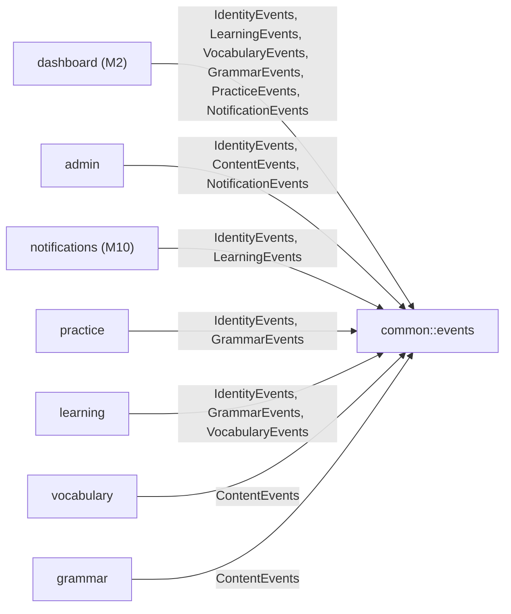

# M10 + M2 Final Summary Report — MasterEnglishhh Backend

## 1. Kiến trúc cuối cùng & Module Dependency Map

Hệ thống duy trì kiến trúc **Spring Modulith** với kiểm soát nghiêm ngặt từ `ArchitectureTests` và `LayerArchitectureTests`: không có bất kỳ phụ thuộc Java trực tiếp nào giữa các module nghiệp vụ (`identity`, `content`, `vocabulary`, `learning`, `grammar`, `practice`, `notifications`, `dashboard`, `admin`). Toàn bộ giao tiếp liên module đi qua các facade sự kiện đồng bộ trong `common/events` (`EventReply<T>` + `@EventListener`) và `RevisionPublished` cho projection.

## 2. Migration Timeline

| Version | Nguồn | Nội dung | Trạng thái |
|---|---|---|---|
| `V1`–`V9` | `origin/main` | Modulith outbox, Identity/OTP/Reset, Content/Vocabulary, Catalog views (`V8_1`), `feature_flags` (`V9`) | Đã có trên `origin/main` |
| `V10` | `origin/main` | `grammar_topics`, `grammar_lessons` | Đã có trên `origin/main` |
| `V11` | `feat/m10-notification-complete` | `notification_preferences`, `reminder_rules`, `notifications`, `notification_deliveries` *(nguyên bản từ `origin/feat/thong-bao-nhac-hoc-v11`)* | Trong PR #16 (khớp khe V11 với `out-of-order=true`) |
| `V12`–`V13` | `origin/main` | `lesson_progress` (`V12`), `practice_engine` Grammar (`V13`) | Đã có trên `origin/main` |
| `V14+` | *Chưa tạo (BLOCKED)* | `study_sessions`, `practice/results` TOEIC & `mistake_records` (`V15` đang được dùng trên `origin/feat/m08-content-ops`) | **DỪNG** chờ xác minh `flyway_schema_history` trên DB dùng chung |

## 3. API Inventory (M10 + M2)

### M10 — Notification & Reminder
- Learner (`LEARNER`):
  - `GET /api/v1/notifications` *(hỗ trợ `type`, `unreadOnly`, `page`, `size`)*
  - `GET /api/v1/notifications/unread-count`
  - `POST /api/v1/notifications/{id}/read`
  - `POST /api/v1/notifications/read-all`
  - `GET /api/v1/notifications/preferences`
  - `PUT /api/v1/notifications/preferences` *(atomic upsert)*
  - `GET /api/v1/notifications/reminders/history` *(M10.11)*
- Admin (`SYSTEM_ADMIN`):
  - `GET /api/v1/admin/notifications/deliveries` *(M10.09)*
  - `GET /api/v1/admin/notifications/rules` *(M10.10)*
  - `GET /api/v1/admin/notifications/rules/{ruleId}` *(M10.10)*
  - `PUT /api/v1/admin/notifications/rules/{ruleId}` *(M10.10 + `audit_logs`)*
  - `GET /api/v1/admin/notifications/history` *(M10.11)*

### M2 — Learner Dashboard
- Learner (`LEARNER`):
  - `GET /api/v1/dashboard` *(M02.01–M02.06)*

## 4. Kết quả kiểm thử & CI Status

| Hạng mục | Local | GitHub Actions CI |
|---|---|---|
| `feat/m10-notification-complete` (PR #16) | `spotlessCheck`, unit/ArchUnit, `bootJar`: **PASS**; Testcontainers: **NOT RUN** (Docker Desktop không bật) | **PASS** (`run 45456847599`, 6m03s, Docker + PostgreSQL 17 + `bootJar` + Docker build) |
| `feat/m2-learner-dashboard` (PR #17) | `spotlessCheck`, unit/ArchUnit, `bootJar`: **PASS**; Testcontainers: **NOT RUN** (Docker Desktop không bật) | **PASS** (`run 45461522865`, 4m27s, full suite + Docker + `bootJar` + Docker build) |

*(Lưu ý: Trong bộ test hiện có của `origin/main`, `ProposedDatabaseSchemaTests` có annotation `@Disabled` từ trước cho bộ bảng cũ 44 bảng; không có test nào của M10 hoặc M2 bị skip.)*

## 5. Các điểm chặn cần chủ dự án xác nhận trước khi mở rộng tiếp
1. **Lịch sử Flyway thực tế (`flyway_schema_history`)** trên staging/EC2 (đã chạy tới V9, V10, V11 bản `dev` hay V13?) và thống nhất thứ tự đánh số `V14` / `V15` (`origin/feat/m08-content-ops`) / `V16` cho `study_sessions` + `Practice/Results` TOEIC + `mistake_records`.
2. **Quy tắc nghiệp vụ M10.07 (`CONTENT_NEW`):** loại nội dung nào phát thông báo (`GRAMMAR_LESSON`, `DECK`, `WORD`, `PRACTICE_SET`), nhóm learner nhận (tất cả `ACTIVE` hay opt-in), kênh gửi (`IN_APP` hay cả `EMAIL`).
3. **Kích hoạt M10.06 (`DAILY_GOAL`):** phụ thuộc migration `study_sessions` và seed rule `DAILY_GOAL` trong `reminder_rules` + xác nhận ngưỡng nhắc (nhắc khi `todayActiveMinutes < dailyMinutes` tại `dailyReminderTime` hay chỉ nhắc khi chưa học).

## 6. Hướng dẫn Review & Kiểm thử
1. Review và merge **PR #16** (`feat/m10-notification-complete` -> `main`): https://github.com/MasterEnglishhh/masterenglish-api/pull/16
2. Sau khi merge PR #16 (hoặc chuyển base PR #17 về `main`), review và merge **PR #17** (`feat/m2-learner-dashboard` -> `feat/m10-notification-complete`): https://github.com/MasterEnglishhh/masterenglish-api/pull/17
3. Kiểm tra `flyway_schema_history` trên staging DB trước khi chạy deploy hoặc tạo migration `V14+`.
